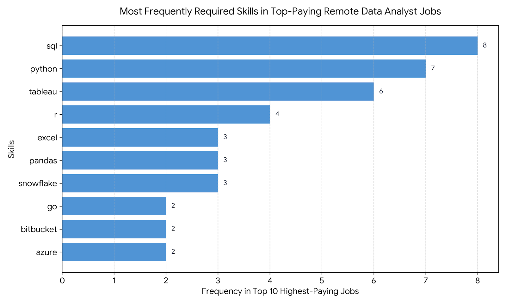
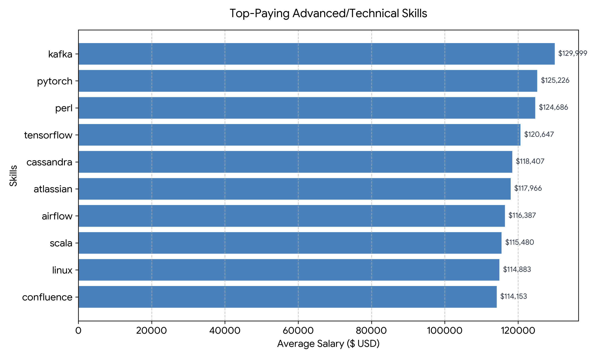
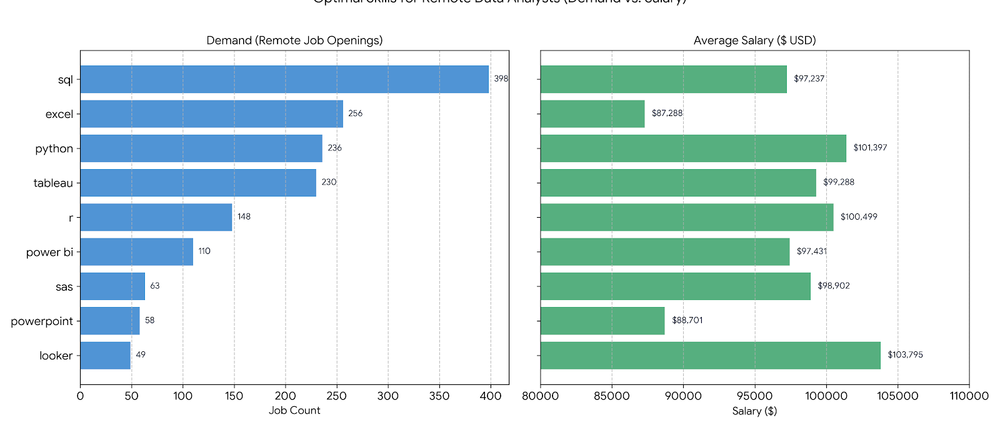

# INTODUCTION

# 📊 Data Analyst Job Market Analysis Using SQL

Explore the data analyst job market through SQL! This project focuses on identifying 💰 the highest-paying data analyst jobs, 🔥 the most in-demand skills, and 📈 the skills that combine strong market demand with high salaries.

🔍 **SQL queries:** Explore the analysis in the [`Job_Analysis_Project_With_SQL`](./SQL/) folder.

&nbsp;

## Background

As an aspiring Data Analyst, I created this project to better understand the job market and identify the skills and opportunities that matter most for building a successful career in data analytics. The goal is to use SQL to answer real-world questions about salaries, job demand, and the skills employers value most.

&nbsp;

## Data Source

The dataset comes from the [SQL Course by Luke Barousse](https://lukebarousse.com/sql). It contains job-market information, including job titles, salaries, locations, and required skills, providing a foundation for exploring trends and uncovering actionable insights.

&nbsp;

## The questions I wanted to answer through my SQL queries were:

1. What are the top-paying data analyst jobs?
2. What skills are required for these top-paying jobs?
3. What skills are most in demand for data analysts?
4. Which skills are associated with higher salaries?
5. What are the most optimal skills to learn?

&nbsp;

# TOOLS I USED

For my deep dive into the data analyst job market, I harnessed the power of several key tools:

- **SQL:** The backbone of my analysis, allowing me to query the database and unearth critical insights.
- **PostgreSQL:** The chosen database management system, ideal for handling the job posting data.
- **Visual Studio Code:** My go-to for database management and executing SQL queries.
- **Git & GitHub:** Essential for version control and sharing my SQL scripts and analysis, ensuring collaboration and project tracking.

    &nbsp;

# THE ANALYSIS

This project uses SQL to explore the data analyst job market and answer key questions about salaries, job opportunities, and in-demand skills.

### Questions Explored

## &nbsp;

### **1. Top-Paying Data Analyst Jobs:** Identify the highest-paying data analyst positions, focusing on full-time, remote opportunities with disclosed salaries.

&nbsp;

### **SQL QUERY**

```sql
SELECT
    job_id,
    job_title,
    job_schedule_type,
    job_location,
    job_posted_date::DATE,
    ROUND(salary_year_avg, 0) as salary_year_avg,
    companies.name as company_name
FROM
    job_postings_fact AS jobs
    -- left join with the company_dim table using the company_id
    INNER JOIN company_dim AS companies ON jobs.company_id = companies.company_id
WHERE
    -- DATA Analyst Role
    job_title_short = 'Data Analyst'
    -- Full Time Job
    AND job_schedule_type = 'Full-time'
    -- ignore the Null result
    AND salary_year_avg IS NOT NULL
    -- GET Remote Jobs
    AND job_location = 'Anywhere'
    -- Descending Order by yearly salary
ORDER BY
    salary_year_avg DESC
    -- display only 10 results
LIMIT
    10;
```

### **THE RESULT**

### [`JSON File`](./JSON/1_top_paying_jobs.json)

### [`SQL File`](./SQL/1_top_paying_jobs.sql)


> [!NOTE]
>
> **Massive Outlier at the Peak:**
>
> Mantys leads the ranking significantly at $650,000 for a standard "Data Analyst" title. In job market datasets, exceptionally high single-posting salaries for early or mid-tier titles can represent executive equity packages, high-end consulting contracts, or unique compensation reporting structures.
>
> **Leadership & Senior Titles Command Top Dollar:**
>
> Positions such as Director of Analytics (Meta at $336,500), Associate Director (AT&T at $255,830), and various Principal Data Analyst roles (SmartAsset, Motional ranging from $186k to $205k) clearly demonstrate that scaling up compensation requires stepping into leadership, architecture, or principal-level analytical responsibilities.
>
> **Remote Flexibility at Elite Companies:**
>
> Major industry players like Meta, AT&T, and Pinterest offer fully remote positions ("Anywhere") with salaries comfortably exceeding $230k, proving that remote workers can secure top-tier tech compensation without traditional office constraints.

## &nbsp;

### **2. Skills Required for Top-Paying Jobs:** Analyze the skills associated with the highest-paying data analyst positions.

### **SQL QUERY**

```SQL
WITH
    top_paying_data_jobs AS (
        SELECT
            job_id,
            job_title,
            job_schedule_type,
            job_location,
            ROUND(salary_year_avg, 0) as salary_year_avg,
            companies.name as company_name
        FROM
            job_postings_fact AS jobs
            -- left join with the company_dim table using the company_id
            LEFT JOIN company_dim AS companies ON jobs.company_id = companies.company_id
        WHERE
            -- DATA Analyst Role
            job_title_short = 'Data Analyst'
            -- Full Time Job
            AND job_schedule_type = 'Full-time'
            -- ignore the Null result
            AND salary_year_avg IS NOT NULL
            -- GET Remote Jobs
            AND job_location = 'Anywhere'
            -- Descending Order by yearly salary
        ORDER BY
            salary_year_avg DESC
            -- display only 10 results
        LIMIT
            10
    )
SELECT
    top_paying_data_jobs.*,
    skills_job_dim.skill_id,
    skills_dim.skills
FROM
    top_paying_data_jobs
    -- Inner join between skills_job_dim and job_postings_fact table using the job_id
    INNER JOIN skills_job_dim ON top_paying_data_jobs.job_id = skills_job_dim.job_id
    -- Inner join between skills_dim and skills_job_dim table using the skill_id
    INNER JOIN skills_dim ON skills_job_dim.skill_id = skills_dim.skill_id
    -- order by yearly salary
ORDER BY
    salary_year_avg DESC;
```

### **THE RESULT**

### [`JSON File`](./JSON/2_top_paying_job_skills.json)

### [`SQL File`](./SQL/2_top_paying_job_skills.sql)



> [!NOTE]
>
> **SQL & Python** Rule the Top Tier: While **Excel** is great for general entry-level work, reaching six-figure executive and principal roles heavily depends on mastering SQL (80%) and Python (70%).
>
> **Modern Cloud & BI Integration:** Top-paying positions increasingly look for candidates familiar with cloud data warehouses like **Snowflake**, cloud platforms like **Azure**, and enterprise visualization suites like **Tableau**.
> the result

## &nbsp;

### **3. Most In-Demand Skills:** Identify the skills most frequently requested by employers in data analyst job postings.

### **SQL QUERY**

```SQL
SELECT
    skills.skills,
    count(skills_job_dim.job_id) AS skill_demand
FROM
    job_postings_fact AS j
    -- Inner join between skills_job_dim and job_postings_fact table using the job_id
    INNER JOIN skills_job_dim ON skills_job_dim.job_id = j.job_id
    -- Inner join between skills_dim and skills_job_dim table using the skill_id
    INNER JOIN skills_dim AS skills ON skills.skill_id = skills_job_dim.skill_id
WHERE
    j.job_title_short = 'Data Analyst'
    -- AND job_location LIKE '%Anywhere%'
    -- AND job_posted_date BETWEEN '2023-01-01' AND '2023-09-30'
    -- j.job_title_short = 'Data Enginner'
GROUP BY
    skills
ORDER BY
    skill_demand DESC
LIMIT
    5;
```

### **THE RESULT**

### [`JSON File`](./JSON/3_top_demanded_skills.json)

### [`SQL File`](./SQL/3_top_demanded_skills.sql)


> **[!NOTE]**
>
> **SQL Rules the Job Market:**
>
> With 92,628 job postings, **SQL** is significantly ahead of all other skills. This emphasizes that database querying and data retrieval are core prerequisites for any professional entering the data analyst job market.
>
> **Traditional Tools vs. Programming:**
>
> **Excel** still holds a commanding second place (67,031 postings), proving that spreadsheets are far from obsolete in daily business tasks. However, programming languages like **Python** (57,326) are closing the gap as organizations demand deeper automation and scalable data processing.
>
> **Visualization Battle (Tableau vs. Power BI):**
>
> Both major dashboarding tools appear prominently in the top 5, with **Tableau** leading slightly in volume within this dataset, demonstrating that communicating insights visually to stakeholders is just as crucial as extracting the data.

## &nbsp;

### **4. Skills Associated with Higher Salaries:** Explore the relationship between specific skills and average data analyst salaries.

### **SQL QUERY**

```SQL
SELECT
    -- the averege salary
    ROUND(AVG(j.salary_year_avg), 0) as avg_salary,
    -- skills
    skills.skills
FROM
    job_postings_fact as j
    -- inner join between the job_postings_fact and skills_job_dim table using the job_id
    INNER JOIN skills_job_dim ON j.job_id = skills_job_dim.job_id
    -- inner join between the skills_job_dim and skills_dim table using the job_id
    INNER JOIN skills_dim as skills ON skills.skill_id = skills_job_dim.skill_id
WHERE
    -- data analyst roles
    job_title_short = 'Data Analyst'
    -- salary is not NULL
    AND j.salary_year_avg IS NOT NULL
GROUP BY
    skills.skills
HAVING
    COUNT(DISTINCT j.job_id) >= 10
ORDER BY
    avg_salary DESC
LIMIT
    10;
```

### **THE RESULT**

### [JSON File](./JSON/4_top_paying_skills.json)

### [SQL File](./SQL/4_top_paying_skills.sql)



> [!NOTE]
>
> **Streaming & Real-Time Data Lead the Way:**
>
> **Apache Kafka** commands the highest average salary in this group at $129,999, highlighting the massive corporate value placed on real-time data streaming architectures.
>
> **Strong Demand for AI and Deep Learning:**
>
> **Both PyTorch** ($125,226) and **TensorFlow** ($120,647) rank near the very top, reflecting the high financial rewards for professionals skilled in machine learning and advanced artificial intelligence engineering.
>
> **Data Pipelines & Infrastructure Matter:**
>
> Tools focused on modern big data infrastructure—such as **Cassandra** (NoSQL), **Airflow** (Orchestration), and **Scala** (Big Data)—consistently deliver salaries exceeding $115,000, proving that backend engineering and data pipeline automation are exceptionally lucrative skills.

## &nbsp;

### **5. Optimal Skills to Learn:** Identify skills that combine strong employer demand with competitive salaries.

### **SQL QUERY**

```SQL
SELECT
    skills.skills,
    skills.skill_id,
    ROUND(AVG(j.salary_year_avg), 0) as avg_salary,
    COUNT(skills_job_dim.job_id) as skills_demand
FROM
    job_postings_fact as j
    -- inner join between the job_postings_fact and skills_job_dim table using the job_id
    INNER JOIN skills_job_dim ON j.job_id = skills_job_dim.job_id
    -- inner join between the skills_job_dim and skills_dim table using the job_id
    INNER JOIN skills_dim as skills ON skills.skill_id = skills_job_dim.skill_id
WHERE
    -- Data Analyst roles
    j.job_title_short = 'Data Analyst'
    -- salary NOT NULL
    AND j.salary_year_avg IS NOT NULL
    -- work from home job
    and j.job_work_from_home IS TRUE
GROUP BY
    skills.skill_id
HAVING
    COUNT(skills_job_dim.job_id) > 10
ORDER BY
    -- avg_salary DESC,
    skills_demand DESC
LIMIT
    10;
```

### **THE RESULT**

### [`JSON File`](./JSON/5_optimal_skills.json)

### [`SQL File`](./SQL/5_optimal_skills.sql)



> [!NOTE]
>
> The analysis of remote Data Analyst job postings with reported annual salaries revealed that **SQL was the most frequently requested skill**, appearing in 398 qualifying job–skill associations, followed by Excel (256), Python (236), and Tableau (230).
>
> **Python** combined substantial demand with a high average annual salary of $101,397. **Looker** recorded the highest average salary among the displayed results at $103,795, although its demand was considerably lower, at 49 associations. **Excel** had strong demand but a lower average salary of $87,288.
>
> These findings suggest that **SQL is a strong foundational skill**, while **Python** and business intelligence tools can complement it. However, salary averages should be interpreted alongside the number of qualifying job postings, and the results represent associations within this dataset rather than guaranteed salaries or future job opportunities.

## &nbsp;

### Tools & Techniques

- **SQL (PostgreSQL):** Data querying, filtering, aggregation, and analysis.
- **Joins:** Combine job postings, company information, and required skills across related tables.
- **Common Table Expressions (CTEs):** Structure complex queries into readable, manageable steps.
- **Aggregate Functions:** Use `COUNT()`, `AVG()`, and other functions to summarize job-market trends.
- **Window Functions:** Analyze and rank job opportunities and skill-related salary trends.

&nbsp;

# WHAT I LEARNED

Through this project, I strengthened my SQL skills and gained a better understanding of how to analyze real-world job market data.

- **Writing Complex SQL Queries:** Used filtering, sorting, grouping, and aggregate functions to answer specific business questions.
- **Joining Multiple Tables:** Combined job postings, company information, and skill data to uncover relationships between salaries, job opportunities, and required skills.
- **Using Common Table Expressions (CTEs):** Organized complex queries into smaller, more readable steps to simplify analysis.
- **Analyzing Salary Trends:** Compared salaries across job titles and skills to identify high-paying opportunities and understand the factors associated with higher compensation.
- **Identifying In-Demand Skills:** Analyzed job postings to determine which technical skills employers request most frequently.
- **Evaluating Skills for Career Development:** Compared skill demand with average salaries to identify potentially valuable skills for aspiring data analysts.
- **Communicating Data Insights:** Learned to turn SQL query results into meaningful findings that can support career planning and better decision-making.

This project helped me move beyond learning SQL syntax and apply it to practical questions, developing my ability to use data to investigate problems and extract useful insights.

&nbsp;

# CONCLUSION

This project provided a practical overview of the data analyst job market by examining salaries, job requirements, and skill demand using SQL and PostgreSQL.

The analysis highlighted several important findings:

- **SQL is a fundamental skill:** It appeared as the most frequently requested skill in the dataset, emphasizing the importance of database querying in data analytics.
- **Excel and Python are valuable additions:** Both appeared among the most in-demand skills, demonstrating the importance of combining data manipulation with programming and automation.
- **Specialized technical skills can offer higher salaries:** Some skills were associated with higher average salaries, although these results can be influenced by a small number of job postings and unusually high salaries.
- **Demand and salary should be considered together:** The most useful skills to prioritize are not necessarily those with the highest average salaries, but those that combine meaningful employer demand with competitive compensation.

Overall, this project strengthened my SQL and analytical skills while helping me better understand the skills and opportunities in the data analyst job market. It also reinforced the importance of validating results, considering outliers, and interpreting data in context before drawing conclusions.

**Next Steps:** Continue developing my data analysis portfolio by applying these skills to new datasets and expanding my knowledge of Excel and Power BI to build more comprehensive analyses and interactive dashboards.
