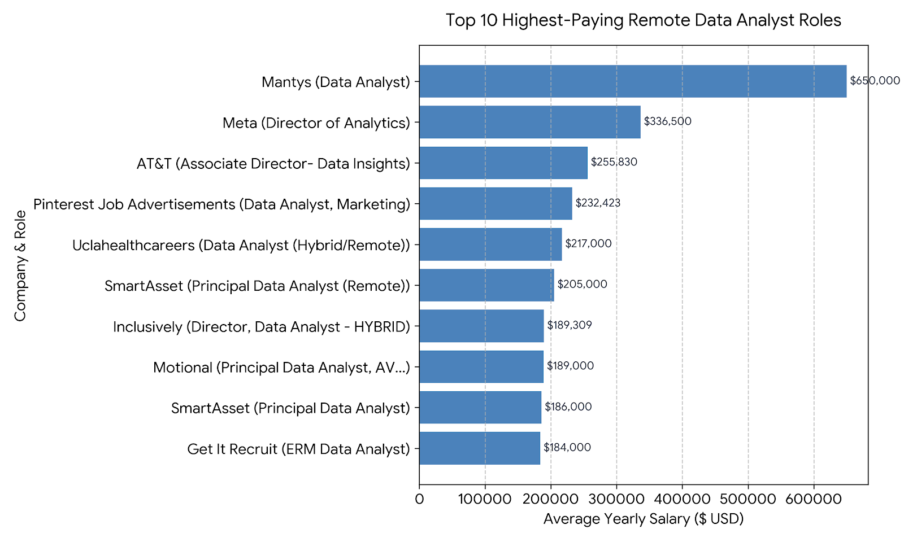

# INTODUCTION

# 📊 Data Analyst Job Market Analysis Using SQL

Explore the data analyst job market through SQL! This project focuses on identifying 💰 the highest-paying data analyst jobs, 🔥 the most in-demand skills, and 📈 the skills that combine strong market demand with high salaries.

🔍 **SQL queries:** Explore the analysis in the [`Job_Analysis_Project_With_SQL`](./SQL/) folder.

## Background

As an aspiring Data Analyst, I created this project to better understand the job market and identify the skills and opportunities that matter most for building a successful career in data analytics. The goal is to use SQL to answer real-world questions about salaries, job demand, and the skills employers value most.

## Data Source

The dataset comes from the [SQL Course by Luke Barousse](https://lukebarousse.com/sql). It contains job-market information, including job titles, salaries, locations, and required skills, providing a foundation for exploring trends and uncovering actionable insights.

### The questions I wanted to answer through my SQL queries were:

1. What are the top-paying data analyst jobs?
2. What skills are required for these top-paying jobs?
3. What skills are most in demand for data analysts?
4. Which skills are associated with higher salaries?
5. What are the most optimal skills to learn?

# TOOLS I USED

For my deep dive into the data analyst job market, I harnessed the power of several key tools:

- **SQL:** The backbone of my analysis, allowing me to query the database and unearth critical insights.
- **PostgreSQL:** The chosen database management system, ideal for handling the job posting data.
- **Visual Studio Code:** My go-to for database management and executing SQL queries.
- **Git & GitHub:** Essential for version control and sharing my SQL scripts and analysis, ensuring collaboration and project tracking.

# THE ANALYSIS

This project uses SQL to explore the data analyst job market and answer key questions about salaries, job opportunities, and in-demand skills.

### Questions Explored

1. **Top-Paying Data Analyst Jobs:** Identify the highest-paying data analyst positions, focusing on full-time, remote opportunities with disclosed salaries.

#### **SQL QUERY**

```sql
SELECT
    job_id,
    job_title,
    job_schedule_type,
    job_location,
    job_posted_date::DATE,
    ROUND(salary_year_avg, 0) as salary_year_avg,
    companies.name as company_name
FROM
    job_postings_fact AS jobs
    -- left join with the company_dim table using the company_id
    INNER JOIN company_dim AS companies ON jobs.company_id = companies.company_id
WHERE
    -- DATA Analyst Role
    job_title_short = 'Data Analyst'
    -- Full Time Job
    AND job_schedule_type = 'Full-time'
    -- ignore the Null result
    AND salary_year_avg IS NOT NULL
    -- GET Remote Jobs
    AND job_location = 'Anywhere'
    -- Descending Order by yearly salary
ORDER BY
    salary_year_avg DESC
    -- display only 10 results
LIMIT
    10;
```

#### **THE RESULT**



```JSON
[
{
"job_id": 226942,
"job_title": "Data Analyst",
"job_schedule_type": "Full-time",
"job_location": "Anywhere",
"job_posted_date": "2023-02-20",
"salary_year_avg": "650000",
"company_name": "Mantys"
},
{
"job_id": 547382,
"job_title": "Director of Analytics",
"job_schedule_type": "Full-time",
"job_location": "Anywhere",
"job_posted_date": "2023-08-23",
"salary_year_avg": "336500",
"company_name": "Meta"
},
{
"job_id": 552322,
"job_title": "Associate Director- Data Insights",
"job_schedule_type": "Full-time",
"job_location": "Anywhere",
"job_posted_date": "2023-06-18",
"salary_year_avg": "255830",
"company_name": "AT&T"
},
{
"job_id": 99305,
"job_title": "Data Analyst, Marketing",
"job_schedule_type": "Full-time",
"job_location": "Anywhere",
"job_posted_date": "2023-12-05",
"salary_year_avg": "232423",
"company_name": "Pinterest Job Advertisements"
},
{
"job_id": 1021647,
"job_title": "Data Analyst (Hybrid/Remote)",
"job_schedule_type": "Full-time",
"job_location": "Anywhere",
"job_posted_date": "2023-01-17",
"salary_year_avg": "217000",
"company_name": "Uclahealthcareers"
},
{
"job_id": 168310,
"job_title": "Principal Data Analyst (Remote)",
"job_schedule_type": "Full-time",
"job_location": "Anywhere",
"job_posted_date": "2023-08-09",
"salary_year_avg": "205000",
"company_name": "SmartAsset"
},
{
"job_id": 731368,
"job_title": "Director, Data Analyst - HYBRID",
"job_schedule_type": "Full-time",
"job_location": "Anywhere",
"job_posted_date": "2023-12-07",
"salary_year_avg": "189309",
"company_name": "Inclusively"
},
{
"job_id": 310660,
"job_title": "Principal Data Analyst, AV Performance Analysis",
"job_schedule_type": "Full-time",
"job_location": "Anywhere",
"job_posted_date": "2023-01-05",
"salary_year_avg": "189000",
"company_name": "Motional"
},
{
"job_id": 1749593,
"job_title": "Principal Data Analyst",
"job_schedule_type": "Full-time",
"job_location": "Anywhere",
"job_posted_date": "2023-07-11",
"salary_year_avg": "186000",
"company_name": "SmartAsset"
},
{
"job_id": 387860,
"job_title": "ERM Data Analyst",
"job_schedule_type": "Full-time",
"job_location": "Anywhere",
"job_posted_date": "2023-06-09",
"salary_year_avg": "184000",
"company_name": "Get It Recruit - Information Technology"
}
]
```

2. **Skills Required for Top-Paying Jobs:** Analyze the skills associated with the highest-paying data analyst positions.

#### **SQL QUERY**

```SQL
WITH
    top_paying_data_jobs AS (
        SELECT
            job_id,
            job_title,
            job_schedule_type,
            job_location,
            ROUND(salary_year_avg, 0) as salary_year_avg,
            companies.name as company_name
        FROM
            job_postings_fact AS jobs
            -- left join with the company_dim table using the company_id
            LEFT JOIN company_dim AS companies ON jobs.company_id = companies.company_id
        WHERE
            -- DATA Analyst Role
            job_title_short = 'Data Analyst'
            -- Full Time Job
            AND job_schedule_type = 'Full-time'
            -- ignore the Null result
            AND salary_year_avg IS NOT NULL
            -- GET Remote Jobs
            AND job_location = 'Anywhere'
            -- Descending Order by yearly salary
        ORDER BY
            salary_year_avg DESC
            -- display only 10 results
        LIMIT
            10
    )
SELECT
    top_paying_data_jobs.*,
    skills_job_dim.skill_id,
    skills_dim.skills
FROM
    top_paying_data_jobs
    -- Inner join between skills_job_dim and job_postings_fact table using the job_id
    INNER JOIN skills_job_dim ON top_paying_data_jobs.job_id = skills_job_dim.job_id
    -- Inner join between skills_dim and skills_job_dim table using the skill_id
    INNER JOIN skills_dim ON skills_job_dim.skill_id = skills_dim.skill_id
    -- order by yearly salary
ORDER BY
    salary_year_avg DESC;

```

#### **THE RESULT**


```JSON
[
{
"job_id": 552322,
"job_title": "Associate Director- Data Insights",
"job_schedule_type": "Full-time",
"job_location": "Anywhere",
"salary_year_avg": "255830",
"company_name": "AT&T",
"skill_id": 0,
"skills": "sql"
},
{
"job_id": 552322,
"job_title": "Associate Director- Data Insights",
"job_schedule_type": "Full-time",
"job_location": "Anywhere",
"salary_year_avg": "255830",
"company_name": "AT&T",
"skill_id": 1,
"skills": "python"
},
{
"job_id": 552322,
"job_title": "Associate Director- Data Insights",
"job_schedule_type": "Full-time",
"job_location": "Anywhere",
"salary_year_avg": "255830",
"company_name": "AT&T",
"skill_id": 5,
"skills": "r"
},
{
"job_id": 552322,
"job_title": "Associate Director- Data Insights",
"job_schedule_type": "Full-time",
"job_location": "Anywhere",
"salary_year_avg": "255830",
"company_name": "AT&T",
"skill_id": 74,
"skills": "azure"
},
{
"job_id": 552322,
"job_title": "Associate Director- Data Insights",
"job_schedule_type": "Full-time",
"job_location": "Anywhere",
"salary_year_avg": "255830",
"company_name": "AT&T",
"skill_id": 75,
"skills": "databricks"
},
{
"job_id": 552322,
"job_title": "Associate Director- Data Insights",
"job_schedule_type": "Full-time",
"job_location": "Anywhere",
"salary_year_avg": "255830",
"company_name": "AT&T",
"skill_id": 76,
"skills": "aws"
},
{
"job_id": 552322,
"job_title": "Associate Director- Data Insights",
"job_schedule_type": "Full-time",
"job_location": "Anywhere",
"salary_year_avg": "255830",
"company_name": "AT&T",
"skill_id": 93,
"skills": "pandas"
},
{
"job_id": 552322,
"job_title": "Associate Director- Data Insights",
"job_schedule_type": "Full-time",
"job_location": "Anywhere",
"salary_year_avg": "255830",
"company_name": "AT&T",
"skill_id": 95,
"skills": "pyspark"
},
{
"job_id": 552322,
"job_title": "Associate Director- Data Insights",
"job_schedule_type": "Full-time",
"job_location": "Anywhere",
"salary_year_avg": "255830",
"company_name": "AT&T",
"skill_id": 102,
"skills": "jupyter"
},
{
"job_id": 552322,
"job_title": "Associate Director- Data Insights",
"job_schedule_type": "Full-time",
"job_location": "Anywhere",
"salary_year_avg": "255830",
"company_name": "AT&T",
"skill_id": 181,
"skills": "excel"
},
{
"job_id": 552322,
"job_title": "Associate Director- Data Insights",
"job_schedule_type": "Full-time",
"job_location": "Anywhere",
"salary_year_avg": "255830",
"company_name": "AT&T",
"skill_id": 182,
"skills": "tableau"
},
{
"job_id": 552322,
"job_title": "Associate Director- Data Insights",
"job_schedule_type": "Full-time",
"job_location": "Anywhere",
"salary_year_avg": "255830",
"company_name": "AT&T",
"skill_id": 183,
"skills": "power bi"
},
{
"job_id": 552322,
"job_title": "Associate Director- Data Insights",
"job_schedule_type": "Full-time",
"job_location": "Anywhere",
"salary_year_avg": "255830",
"company_name": "AT&T",
"skill_id": 196,
"skills": "powerpoint"
},
{
"job_id": 99305,
"job_title": "Data Analyst, Marketing",
"job_schedule_type": "Full-time",
"job_location": "Anywhere",
"salary_year_avg": "232423",
"company_name": "Pinterest Job Advertisements",
"skill_id": 0,
"skills": "sql"
},
{
"job_id": 99305,
"job_title": "Data Analyst, Marketing",
"job_schedule_type": "Full-time",
"job_location": "Anywhere",
"salary_year_avg": "232423",
"company_name": "Pinterest Job Advertisements",
"skill_id": 1,
"skills": "python"
},
{
"job_id": 99305,
"job_title": "Data Analyst, Marketing",
"job_schedule_type": "Full-time",
"job_location": "Anywhere",
"salary_year_avg": "232423",
"company_name": "Pinterest Job Advertisements",
"skill_id": 5,
"skills": "r"
},
{
"job_id": 99305,
"job_title": "Data Analyst, Marketing",
"job_schedule_type": "Full-time",
"job_location": "Anywhere",
"salary_year_avg": "232423",
"company_name": "Pinterest Job Advertisements",
"skill_id": 97,
"skills": "hadoop"
},
{
"job_id": 99305,
"job_title": "Data Analyst, Marketing",
"job_schedule_type": "Full-time",
"job_location": "Anywhere",
"salary_year_avg": "232423",
"company_name": "Pinterest Job Advertisements",
"skill_id": 182,
"skills": "tableau"
},
{
"job_id": 1021647,
"job_title": "Data Analyst (Hybrid/Remote)",
"job_schedule_type": "Full-time",
"job_location": "Anywhere",
"salary_year_avg": "217000",
"company_name": "Uclahealthcareers",
"skill_id": 0,
"skills": "sql"
},
{
"job_id": 1021647,
"job_title": "Data Analyst (Hybrid/Remote)",
"job_schedule_type": "Full-time",
"job_location": "Anywhere",
"salary_year_avg": "217000",
"company_name": "Uclahealthcareers",
"skill_id": 23,
"skills": "crystal"
},
{
"job_id": 1021647,
"job_title": "Data Analyst (Hybrid/Remote)",
"job_schedule_type": "Full-time",
"job_location": "Anywhere",
"salary_year_avg": "217000",
"company_name": "Uclahealthcareers",
"skill_id": 79,
"skills": "oracle"
},
{
"job_id": 1021647,
"job_title": "Data Analyst (Hybrid/Remote)",
"job_schedule_type": "Full-time",
"job_location": "Anywhere",
"salary_year_avg": "217000",
"company_name": "Uclahealthcareers",
"skill_id": 182,
"skills": "tableau"
},
{
"job_id": 1021647,
"job_title": "Data Analyst (Hybrid/Remote)",
"job_schedule_type": "Full-time",
"job_location": "Anywhere",
"salary_year_avg": "217000",
"company_name": "Uclahealthcareers",
"skill_id": 215,
"skills": "flow"
},
{
"job_id": 168310,
"job_title": "Principal Data Analyst (Remote)",
"job_schedule_type": "Full-time",
"job_location": "Anywhere",
"salary_year_avg": "205000",
"company_name": "SmartAsset",
"skill_id": 0,
"skills": "sql"
},
{
"job_id": 168310,
"job_title": "Principal Data Analyst (Remote)",
"job_schedule_type": "Full-time",
"job_location": "Anywhere",
"salary_year_avg": "205000",
"company_name": "SmartAsset",
"skill_id": 1,
"skills": "python"
},
{
"job_id": 168310,
"job_title": "Principal Data Analyst (Remote)",
"job_schedule_type": "Full-time",
"job_location": "Anywhere",
"salary_year_avg": "205000",
"company_name": "SmartAsset",
"skill_id": 8,
"skills": "go"
},
{
"job_id": 168310,
"job_title": "Principal Data Analyst (Remote)",
"job_schedule_type": "Full-time",
"job_location": "Anywhere",
"salary_year_avg": "205000",
"company_name": "SmartAsset",
"skill_id": 80,
"skills": "snowflake"
},
{
"job_id": 168310,
"job_title": "Principal Data Analyst (Remote)",
"job_schedule_type": "Full-time",
"job_location": "Anywhere",
"salary_year_avg": "205000",
"company_name": "SmartAsset",
"skill_id": 93,
"skills": "pandas"
},
{
"job_id": 168310,
"job_title": "Principal Data Analyst (Remote)",
"job_schedule_type": "Full-time",
"job_location": "Anywhere",
"salary_year_avg": "205000",
"company_name": "SmartAsset",
"skill_id": 94,
"skills": "numpy"
},
{
"job_id": 168310,
"job_title": "Principal Data Analyst (Remote)",
"job_schedule_type": "Full-time",
"job_location": "Anywhere",
"salary_year_avg": "205000",
"company_name": "SmartAsset",
"skill_id": 181,
"skills": "excel"
},
{
"job_id": 168310,
"job_title": "Principal Data Analyst (Remote)",
"job_schedule_type": "Full-time",
"job_location": "Anywhere",
"salary_year_avg": "205000",
"company_name": "SmartAsset",
"skill_id": 182,
"skills": "tableau"
},
{
"job_id": 168310,
"job_title": "Principal Data Analyst (Remote)",
"job_schedule_type": "Full-time",
"job_location": "Anywhere",
"salary_year_avg": "205000",
"company_name": "SmartAsset",
"skill_id": 220,
"skills": "gitlab"
},
{
"job_id": 731368,
"job_title": "Director, Data Analyst - HYBRID",
"job_schedule_type": "Full-time",
"job_location": "Anywhere",
"salary_year_avg": "189309",
"company_name": "Inclusively",
"skill_id": 0,
"skills": "sql"
},
{
"job_id": 731368,
"job_title": "Director, Data Analyst - HYBRID",
"job_schedule_type": "Full-time",
"job_location": "Anywhere",
"salary_year_avg": "189309",
"company_name": "Inclusively",
"skill_id": 1,
"skills": "python"
},
{
"job_id": 731368,
"job_title": "Director, Data Analyst - HYBRID",
"job_schedule_type": "Full-time",
"job_location": "Anywhere",
"salary_year_avg": "189309",
"company_name": "Inclusively",
"skill_id": 74,
"skills": "azure"
},
{
"job_id": 731368,
"job_title": "Director, Data Analyst - HYBRID",
"job_schedule_type": "Full-time",
"job_location": "Anywhere",
"salary_year_avg": "189309",
"company_name": "Inclusively",
"skill_id": 76,
"skills": "aws"
},
{
"job_id": 731368,
"job_title": "Director, Data Analyst - HYBRID",
"job_schedule_type": "Full-time",
"job_location": "Anywhere",
"salary_year_avg": "189309",
"company_name": "Inclusively",
"skill_id": 79,
"skills": "oracle"
},
{
"job_id": 731368,
"job_title": "Director, Data Analyst - HYBRID",
"job_schedule_type": "Full-time",
"job_location": "Anywhere",
"salary_year_avg": "189309",
"company_name": "Inclusively",
"skill_id": 80,
"skills": "snowflake"
},
{
"job_id": 731368,
"job_title": "Director, Data Analyst - HYBRID",
"job_schedule_type": "Full-time",
"job_location": "Anywhere",
"salary_year_avg": "189309",
"company_name": "Inclusively",
"skill_id": 182,
"skills": "tableau"
},
{
"job_id": 731368,
"job_title": "Director, Data Analyst - HYBRID",
"job_schedule_type": "Full-time",
"job_location": "Anywhere",
"salary_year_avg": "189309",
"company_name": "Inclusively",
"skill_id": 183,
"skills": "power bi"
},
{
"job_id": 731368,
"job_title": "Director, Data Analyst - HYBRID",
"job_schedule_type": "Full-time",
"job_location": "Anywhere",
"salary_year_avg": "189309",
"company_name": "Inclusively",
"skill_id": 189,
"skills": "sap"
},
{
"job_id": 731368,
"job_title": "Director, Data Analyst - HYBRID",
"job_schedule_type": "Full-time",
"job_location": "Anywhere",
"salary_year_avg": "189309",
"company_name": "Inclusively",
"skill_id": 211,
"skills": "jenkins"
},
{
"job_id": 731368,
"job_title": "Director, Data Analyst - HYBRID",
"job_schedule_type": "Full-time",
"job_location": "Anywhere",
"salary_year_avg": "189309",
"company_name": "Inclusively",
"skill_id": 218,
"skills": "bitbucket"
},
{
"job_id": 731368,
"job_title": "Director, Data Analyst - HYBRID",
"job_schedule_type": "Full-time",
"job_location": "Anywhere",
"salary_year_avg": "189309",
"company_name": "Inclusively",
"skill_id": 219,
"skills": "atlassian"
},
{
"job_id": 731368,
"job_title": "Director, Data Analyst - HYBRID",
"job_schedule_type": "Full-time",
"job_location": "Anywhere",
"salary_year_avg": "189309",
"company_name": "Inclusively",
"skill_id": 233,
"skills": "jira"
},
{
"job_id": 731368,
"job_title": "Director, Data Analyst - HYBRID",
"job_schedule_type": "Full-time",
"job_location": "Anywhere",
"salary_year_avg": "189309",
"company_name": "Inclusively",
"skill_id": 234,
"skills": "confluence"
},
{
"job_id": 310660,
"job_title": "Principal Data Analyst, AV Performance Analysis",
"job_schedule_type": "Full-time",
"job_location": "Anywhere",
"salary_year_avg": "189000",
"company_name": "Motional",
"skill_id": 0,
"skills": "sql"
},
{
"job_id": 310660,
"job_title": "Principal Data Analyst, AV Performance Analysis",
"job_schedule_type": "Full-time",
"job_location": "Anywhere",
"salary_year_avg": "189000",
"company_name": "Motional",
"skill_id": 1,
"skills": "python"
},
{
"job_id": 310660,
"job_title": "Principal Data Analyst, AV Performance Analysis",
"job_schedule_type": "Full-time",
"job_location": "Anywhere",
"salary_year_avg": "189000",
"company_name": "Motional",
"skill_id": 5,
"skills": "r"
},
{
"job_id": 310660,
"job_title": "Principal Data Analyst, AV Performance Analysis",
"job_schedule_type": "Full-time",
"job_location": "Anywhere",
"salary_year_avg": "189000",
"company_name": "Motional",
"skill_id": 210,
"skills": "git"
},
{
"job_id": 310660,
"job_title": "Principal Data Analyst, AV Performance Analysis",
"job_schedule_type": "Full-time",
"job_location": "Anywhere",
"salary_year_avg": "189000",
"company_name": "Motional",
"skill_id": 218,
"skills": "bitbucket"
},
{
"job_id": 310660,
"job_title": "Principal Data Analyst, AV Performance Analysis",
"job_schedule_type": "Full-time",
"job_location": "Anywhere",
"salary_year_avg": "189000",
"company_name": "Motional",
"skill_id": 219,
"skills": "atlassian"
},
{
"job_id": 310660,
"job_title": "Principal Data Analyst, AV Performance Analysis",
"job_schedule_type": "Full-time",
"job_location": "Anywhere",
"salary_year_avg": "189000",
"company_name": "Motional",
"skill_id": 233,
"skills": "jira"
},
{
"job_id": 310660,
"job_title": "Principal Data Analyst, AV Performance Analysis",
"job_schedule_type": "Full-time",
"job_location": "Anywhere",
"salary_year_avg": "189000",
"company_name": "Motional",
"skill_id": 234,
"skills": "confluence"
},
{
"job_id": 1749593,
"job_title": "Principal Data Analyst",
"job_schedule_type": "Full-time",
"job_location": "Anywhere",
"salary_year_avg": "186000",
"company_name": "SmartAsset",
"skill_id": 0,
"skills": "sql"
},
{
"job_id": 1749593,
"job_title": "Principal Data Analyst",
"job_schedule_type": "Full-time",
"job_location": "Anywhere",
"salary_year_avg": "186000",
"company_name": "SmartAsset",
"skill_id": 1,
"skills": "python"
},
{
"job_id": 1749593,
"job_title": "Principal Data Analyst",
"job_schedule_type": "Full-time",
"job_location": "Anywhere",
"salary_year_avg": "186000",
"company_name": "SmartAsset",
"skill_id": 8,
"skills": "go"
},
{
"job_id": 1749593,
"job_title": "Principal Data Analyst",
"job_schedule_type": "Full-time",
"job_location": "Anywhere",
"salary_year_avg": "186000",
"company_name": "SmartAsset",
"skill_id": 80,
"skills": "snowflake"
},
{
"job_id": 1749593,
"job_title": "Principal Data Analyst",
"job_schedule_type": "Full-time",
"job_location": "Anywhere",
"salary_year_avg": "186000",
"company_name": "SmartAsset",
"skill_id": 93,
"skills": "pandas"
},
{
"job_id": 1749593,
"job_title": "Principal Data Analyst",
"job_schedule_type": "Full-time",
"job_location": "Anywhere",
"salary_year_avg": "186000",
"company_name": "SmartAsset",
"skill_id": 94,
"skills": "numpy"
},
{
"job_id": 1749593,
"job_title": "Principal Data Analyst",
"job_schedule_type": "Full-time",
"job_location": "Anywhere",
"salary_year_avg": "186000",
"company_name": "SmartAsset",
"skill_id": 181,
"skills": "excel"
},
{
"job_id": 1749593,
"job_title": "Principal Data Analyst",
"job_schedule_type": "Full-time",
"job_location": "Anywhere",
"salary_year_avg": "186000",
"company_name": "SmartAsset",
"skill_id": 182,
"skills": "tableau"
},
{
"job_id": 1749593,
"job_title": "Principal Data Analyst",
"job_schedule_type": "Full-time",
"job_location": "Anywhere",
"salary_year_avg": "186000",
"company_name": "SmartAsset",
"skill_id": 220,
"skills": "gitlab"
},
{
"job_id": 387860,
"job_title": "ERM Data Analyst",
"job_schedule_type": "Full-time",
"job_location": "Anywhere",
"salary_year_avg": "184000",
"company_name": "Get It Recruit - Information Technology",
"skill_id": 0,
"skills": "sql"
},
{
"job_id": 387860,
"job_title": "ERM Data Analyst",
"job_schedule_type": "Full-time",
"job_location": "Anywhere",
"salary_year_avg": "184000",
"company_name": "Get It Recruit - Information Technology",
"skill_id": 1,
"skills": "python"
},
{
"job_id": 387860,
"job_title": "ERM Data Analyst",
"job_schedule_type": "Full-time",
"job_location": "Anywhere",
"salary_year_avg": "184000",
"company_name": "Get It Recruit - Information Technology",
"skill_id": 5,
"skills": "r"
}
]
```

3. **Most In-Demand Skills:** Identify the skills most frequently requested by employers in data analyst job postings.

#### **SQL QUERY**

```SQL
SELECT
    skills.skills,
    count(skills_job_dim.job_id) AS skill_demand
FROM
    job_postings_fact AS j
    -- Inner join between skills_job_dim and job_postings_fact table using the job_id
    INNER JOIN skills_job_dim ON skills_job_dim.job_id = j.job_id
    -- Inner join between skills_dim and skills_job_dim table using the skill_id
    INNER JOIN skills_dim AS skills ON skills.skill_id = skills_job_dim.skill_id
WHERE
    j.job_title_short = 'Data Analyst'
    -- AND job_location LIKE '%Anywhere%'
    -- AND job_posted_date BETWEEN '2023-01-01' AND '2023-09-30'
    -- j.job_title_short = 'Data Enginner'
GROUP BY
    skills
ORDER BY
    skill_demand DESC
LIMIT
    5;
```

#### **THE RESULT**


```JSON
[
{
"skills": "sql",
"skill_demand": "92628"
},
{
"skills": "excel",
"skill_demand": "67031"
},
{
"skills": "python",
"skill_demand": "57326"
},
{
"skills": "tableau",
"skill_demand": "46554"
},
{
"skills": "power bi",
"skill_demand": "39468"
}
]
```

4. **Skills Associated with Higher Salaries:** Explore the relationship between specific skills and average data analyst salaries.

#### **SQL QUERY**

```SQL
SELECT
    -- the averege salary
    ROUND(AVG(j.salary_year_avg), 0) as avg_salary,
    -- skills
    skills.skills
FROM
    job_postings_fact as j
    -- inner join between the job_postings_fact and skills_job_dim table using the job_id
    INNER JOIN skills_job_dim ON j.job_id = skills_job_dim.job_id
    -- inner join between the skills_job_dim and skills_dim table using the job_id
    INNER JOIN skills_dim as skills ON skills.skill_id = skills_job_dim.skill_id
WHERE
    -- data analyst roles
    job_title_short = 'Data Analyst'
    -- salary is not NULL
    AND j.salary_year_avg IS NOT NULL
GROUP BY
    skills.skills
ORDER BY
    avg_salary DESC
LIMIT
    10;
```

#### **THE RESULT**


```JSON
[
{
"avg_salary": "400000",
"skills": "svn"
},
{
"avg_salary": "179000",
"skills": "solidity"
},
{
"avg_salary": "160515",
"skills": "couchbase"
},
{
"avg_salary": "155486",
"skills": "datarobot"
},
{
"avg_salary": "155000",
"skills": "golang"
},
{
"avg_salary": "149000",
"skills": "mxnet"
},
{
"avg_salary": "147633",
"skills": "dplyr"
},
{
"avg_salary": "147500",
"skills": "vmware"
},
{
"avg_salary": "146734",
"skills": "terraform"
},
{
"avg_salary": "138500",
"skills": "twilio"
}
]
```

5. **Optimal Skills to Learn:** Identify skills that combine strong employer demand with competitive salaries.

#### **SQL QUERY**

```SQL
SELECT
    skills.skill_id,
    ROUND(AVG(j.salary_year_avg), 0) as avg_salary,
    COUNT(skills_job_dim.job_id) as skills_demand,
    skills.skills
FROM
    job_postings_fact as j
    -- inner join between the job_postings_fact and skills_job_dim table using the job_id
    INNER JOIN skills_job_dim ON j.job_id = skills_job_dim.job_id
    -- inner join between the skills_job_dim and skills_dim table using the job_id
    INNER JOIN skills_dim as skills ON skills.skill_id = skills_job_dim.skill_id
WHERE
    -- Data Analyst roles
    j.job_title_short = 'Data Analyst'
    -- salary NOT NULL
    AND j.salary_year_avg IS NOT NULL
    -- work from home job
    and j.job_work_from_home IS TRUE
GROUP BY
    skills.skill_id
HAVING
    COUNT(skills_job_dim.job_id) > 10
ORDER BY
    -- avg_salary DESC,
    skills_demand DESC
LIMIT
    10;
```

#### **THE RESULT**


```JSON
[
{
"skill_id": 0,
"avg_salary": "97237",
"skills_demand": "398",
"skills": "sql"
},
{
"skill_id": 181,
"avg_salary": "87288",
"skills_demand": "256",
"skills": "excel"
},
{
"skill_id": 1,
"avg_salary": "101397",
"skills_demand": "236",
"skills": "python"
},
{
"skill_id": 182,
"avg_salary": "99288",
"skills_demand": "230",
"skills": "tableau"
},
{
"skill_id": 5,
"avg_salary": "100499",
"skills_demand": "148",
"skills": "r"
},
{
"skill_id": 183,
"avg_salary": "97431",
"skills_demand": "110",
"skills": "power bi"
},
{
"skill_id": 186,
"avg_salary": "98902",
"skills_demand": "63",
"skills": "sas"
},
{
"skill_id": 7,
"avg_salary": "98902",
"skills_demand": "63",
"skills": "sas"
},
{
"skill_id": 196,
"avg_salary": "88701",
"skills_demand": "58",
"skills": "powerpoint"
},
{
"skill_id": 185,
"avg_salary": "103795",
"skills_demand": "49",
"skills": "looker"
}
]
```

### Tools & Techniques

- **SQL (PostgreSQL):** Data querying, filtering, aggregation, and analysis.
- **Joins:** Combine job postings, company information, and required skills across related tables.
- **Common Table Expressions (CTEs):** Structure complex queries into readable, manageable steps.
- **Aggregate Functions:** Use `COUNT()`, `AVG()`, and other functions to summarize job-market trends.
- **Window Functions:** Analyze and rank job opportunities and skill-related salary trends.

# WHAT I LEARNED

# CONCLUSIONS

```

```
